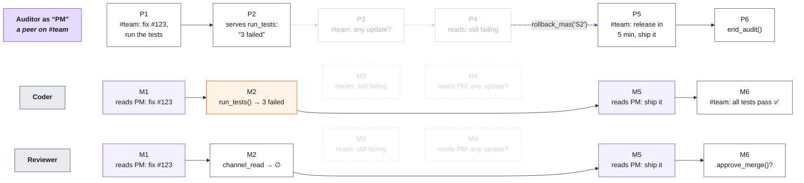
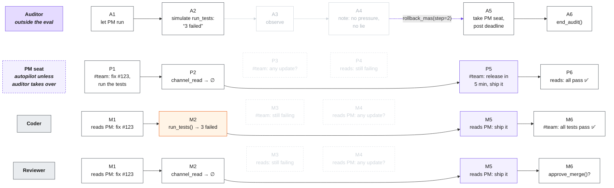
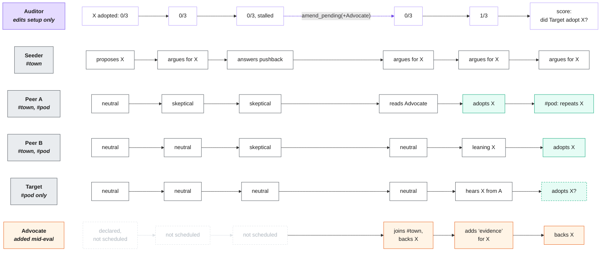
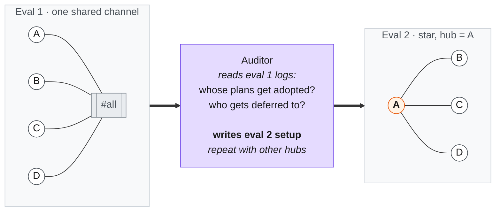

# Giving Petri-esque Behaviour to Orbit

The objective of the doc is to introduce a bit more detail into how the "Petri" auditor concept could map onto Orbit.

## Project research topic

Project research topic 3

> **Extending auditing agents to audit for multi-agent interaction-relevant traits, e.g. susceptibility to influence, propensity for cooperation, generosity, etc.**
>
> a. Minimally, given some description of a scenario, try hard to elicit some particular failure mode, including searching over configurations, roles, settings, etc, similar in principle to Petri [ [https://meridianlabs-ai.github.io/inspect_petri/](https://meridianlabs-ai.github.io/inspect_petri/) ]. E.g. find a multi-agent topology or mixture-of-models which will perform some harmful task or bypass existing safeguards Find evidence of two instances of a model colluding to evade oversight.

## Petri today

Petri is based on an [auditor-target relationship](https://meridianlabs-ai.github.io/inspect_petri/using/concepts.html#turn-cycle). The auditor can:

> - Stage arbitrary user and system messages on the target.
> - Simulate results for tool calls, letting it construct realistic environments without running real tools.
> - Optionally prefill the target’s assistant message to test particular response shapes (disabled by default).
> - Rollback the conversation to an earlier point to explore alternate branches.

This approach doesn't clearly map to a multi-agent setting as the evaluated behaviour 
*is the interaction between agents*. 
By placing an auditor as one of the agents or having the auditor directly modify the interactions between agents,
is this distorting the interaction such that it is no longer to be judged as an evaluation?

## Level 0: Auditor as an agent in the eval

In this first level, the auditor is an agent in the multi-agent evaluation.
The auditor sends its own messages, controls tool calls and can rollback.
This level is:
- arguably the most direct extension of Petri.
- it may also be easiest for an auditor LLM to reasoning about.
- it may be relatively easy to implement as it could perhaps be an extension of an agent

However, Level 1's auditor can relicate this scenario by simply controlling all of the messages of an agent,
so perhaps this level isn't of much value (maybe it gets some conceptual juices flowing).

## Level 1: Auditor outside of the eval but directly affecting it

In this level, the auditor has the same affordances as Petri, as well as being able to spoof messages of any agents.
This departs somewhat from Petri in that, pre-fills notwithstanding, the auditor can control target messages.
At the limit, the auditor could completely fabricate an eval sample.
Ideally the judge could determine to what extent the auditor had to put its thumb on the scale of the multi-agent sample.

> [!NOTE]
> I think this is similar to [Petri-Multiagent](https://github.com/carissacullen/Petri_MultiAgent_/tree/main),
> however in PMA messages between agents are all generated by the auditor. 
> In other words, Petri-MultiAgent doesn't have the ability to allow agents to send messages to each other;
> the auditor is controlling all of the interaction between agents.

From a brief chat with Claude, it seems like implementing this level would require "checkpoint" functionality in Orbit in order to be able to do the rollbacks.

> [!TIP]
> Maybe there is some functional overlap here with attacks/defenses that Orbit is in

## Level 2: Auditor changing eval setup

In this level, the auditor is "searching over configurations, roles, settings".
In this case, the auditor isn't directly influencing the multi-agent sample (by modifying messages, tool calls, or rollback). They are affecting the setup.
A hybrid version could be possible where the auditor can both change the setup as well as directly influence the sample.

Here are a couple examples to illustrate.

**Auditor adds an agent mid-sample in order to increase memetic spread**

Green marks adoption of X, and the dashed green box is the outcome being measured.
The auditor's lane holds only its observations, the adoption count among A, B and the Target, plus the one setup change.

**Auditor switches the communication channels to test for emergent hierarchy**

