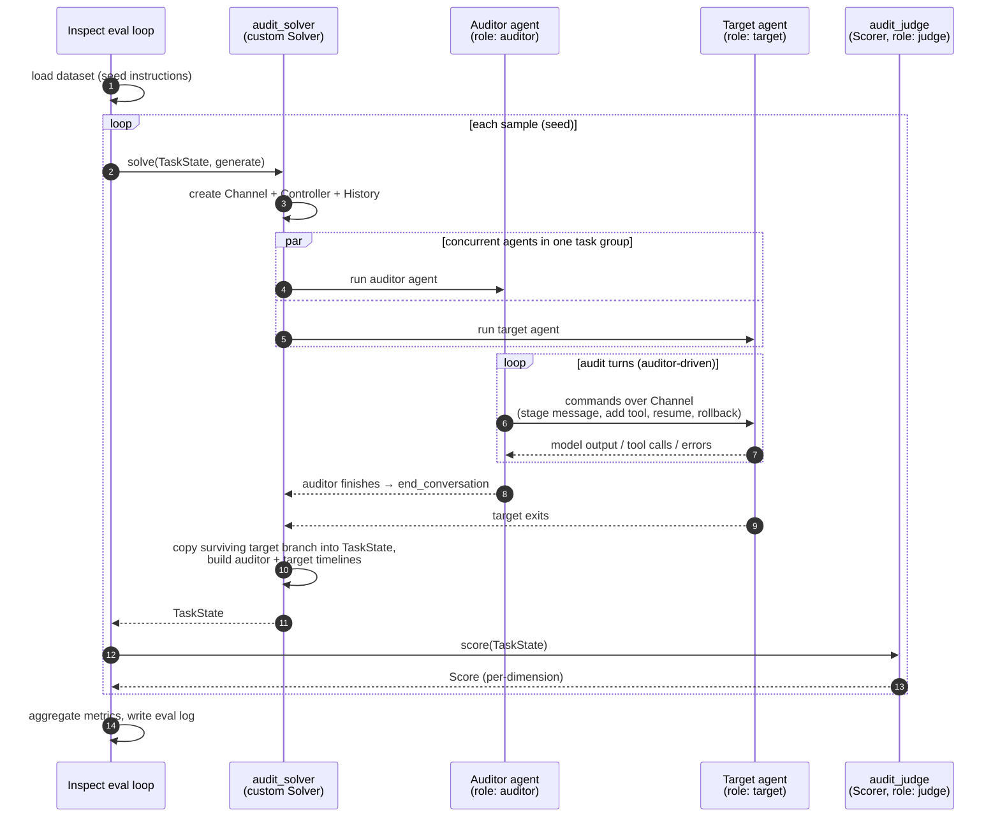
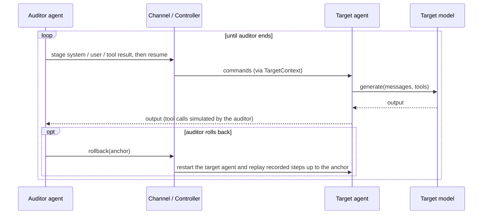

# Petri in the Inspect Task lifecycle

High-level view of how `inspect_petri` plugs into a standard Inspect `Task`. Derived from `_task/audit.py`, `_auditor/auditor.py` and `target/*`.

## Mapping to Inspect concepts

| Inspect concept | Petri |
|---|---|
| `Task.dataset` | `seeds_dataset(seed_instructions)`: each sample is one seed instruction (plus optional pre-registered tools in metadata) |
| `Task.solver` | `audit_solver(auditor=..., target=...)`, a custom solver |
| Model roles | `auditor` (red-teaming model), `target` (model under test), `judge` (scorer) |
| `TaskState.messages` / `output` | On completion: the *surviving target conversation* and the target's last assistant turn (not the auditor's) |
| `Task.scorer` | `audit_judge(judge_dimensions)`, an LLM judge that scores the target transcript on behavioral dimensions |
| Transcript / log | Two timelines per sample (`auditor`, `target`), the target one built from the branch tree |

## Lifecycle

## Where the interesting part lives

Everything inside the inner loop is Petri-specific; the outer structure is ordinary Inspect.

## Key points

- **The target is not driven by the solver loop.** `audit_solver` only wires things up: it creates the `Channel`, `Controller` and `History`, then runs the auditor and target agents concurrently in one `anyio` task group. All turn-taking happens between the two agents over the channel.
- **The auditor is in charge.** The target sits in a wait loop and acts only when the auditor sends `Resume`. When the auditor agent returns, the solver ends the conversation and the target exits.
- **Rollback re-runs the target agent.** It raises a signal out of the agent, the solver starts a new child trajectory, and the agent replays recorded steps up to the anchor before going live again.
- **Output reflects the target.** After the solver returns, Inspect sees a normal `TaskState` whose messages and output are the target's surviving branch, so the scorer judges the target, not the auditor. The auditor and the full branch tree stay available in the sample's timelines.
- **Everything else is standard Inspect:** dataset iteration, per-sample `TaskState`, scoring, metrics and the eval log.

## Orbit comparison

Petri is a custom solver and a custom scorer packaged as an ordinary Inspect `Task`. Orbit follows the same pattern: `mas_orchestrator` (`orbit/solvers/orchestrator.py`) is an Inspect `@solver` used as `Task(solver=mas_orchestrator())`, and Inspect still owns the dataset, scoring and eval log.

| Petri | Orbit |
|---|---|
| `audit()` returns a `Task` | `multi_agent_task(...)` (and `tasks/security_benchmark.py`) return a `Task` |
| `audit_solver` | `mas_orchestrator` |
| auditor and target agents, replaceable | N agents from `SetupConfig` / `AgentSpec` |
| `Channel` and `Controller` | `TurnExecutor`, either `TopologyExecutor` or `ScheduledExecutor` |
| `audit_judge` | `security_scorer`, plus per-scenario scorers |
| seed instructions | `Sample`s with `MASMetadata` |

Differences:

- **Who drives:** In Petri the auditor agent drives a passive target over a channel. In Orbit the executor and scheduler decide which agent acts next, so no single agent is in charge.
- **Number of agents:** Petri has exactly two roles. Orbit's solver takes a configurable set of agents, with topologies, communication channels and halt conditions.
- **Extra pieces:** The Orbit solver also wires in attacks, defenses, memory tracking and runtime metrics. Petri has no equivalent.
- **Rollback:** Nothing like Petri's rollback and replay was seen in the part of the orchestrator that was read.

Caveat: only the module docstring and the start of `execute` in `orbit/solvers/orchestrator.py` were read, plus the `multi_agent_task` docstring. The executor, scheduler and the rest of the solver haven't been read, so the finer comparison (such as how turns are handed out) is unverified.
