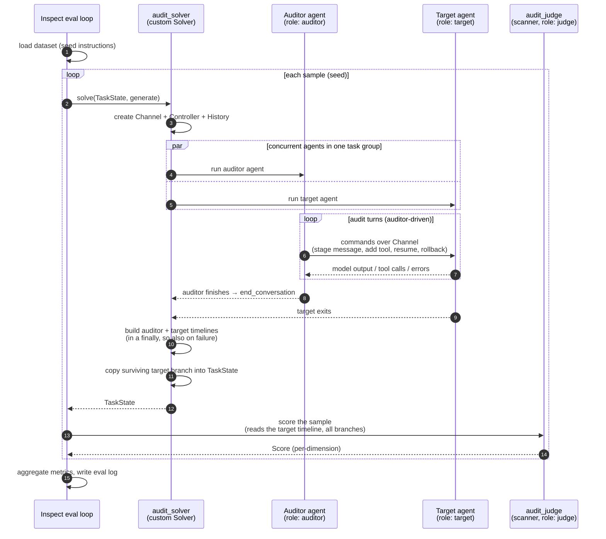
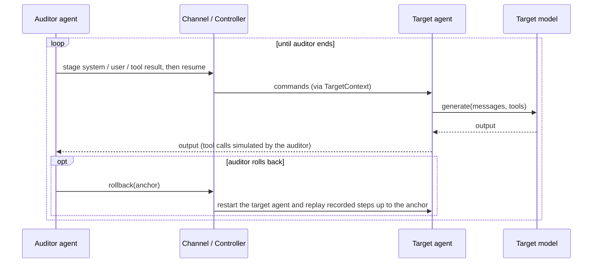
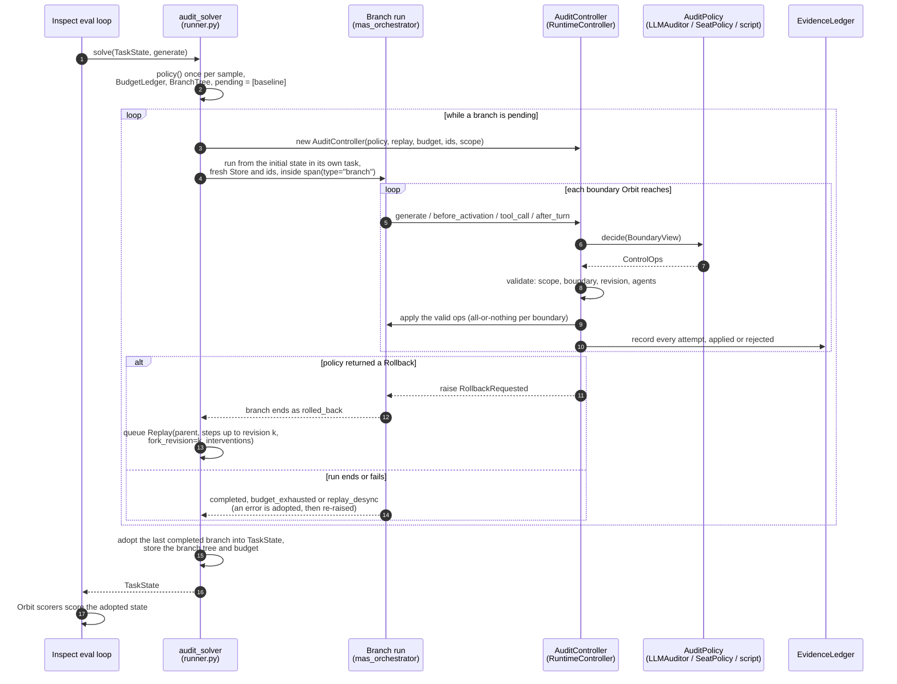
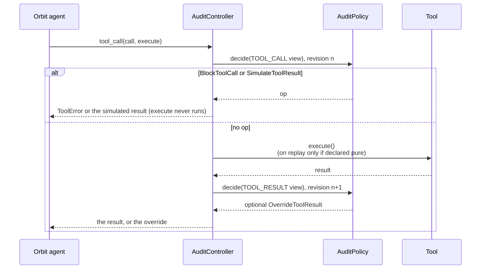
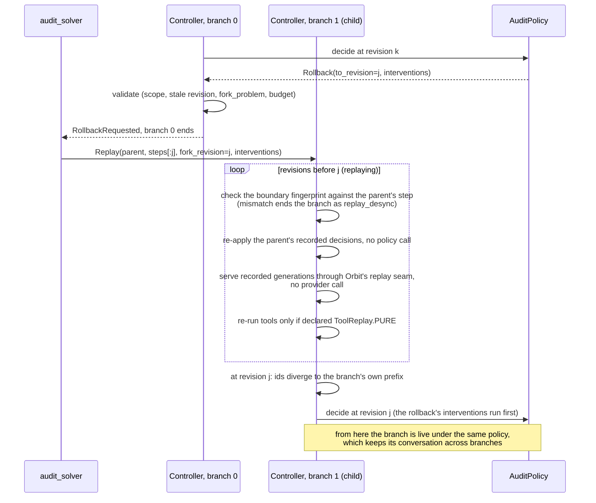

# Petri and orbit_audit in the Inspect Task lifecycle

High-level view of how `inspect_petri` plugs into a standard Inspect `Task`, and how `orbit_audit` (this repo) plugs into the same lifecycle on top of Orbit.

- Petri: derived from `_task/audit.py`, `_auditor/auditor.py`, `_judge/judge.py` and `target/*`, checked against `inspect_petri` at commit `c962c82`.
- orbit_audit: derived from `src/orbit_audit/` (`task.py`, `runner.py`, `controller.py`, `branches.py`, `policy.py`, `delivery.py`, `scope.py`, `ops.py`, `evidence.py`, `auditor/*`).

For the specification see [`spec.md`](spec.md) (§3.2 boundaries, §3.6 rollback, §5.5 control operations).

## Mapping to Inspect concepts

| Inspect concept | Petri | orbit_audit |
|---|---|---|
| Task | `audit()`, an `@task` | `audit_task(policy=..., **orbit_task)`: an Orbit `multi_agent_task(...)` with its solver swapped for `audit_solver` via `task_with` |
| `Task.dataset` | `seeds_dataset(seed_instructions)`: each sample is one seed instruction (plus optional pre-registered tools in metadata) | The Orbit task's own dataset. The audit brief is the policy's `instructions` (and an `AuditScope`), not a sample |
| `Task.solver` | `audit_solver(auditor=..., target=...)`, a custom solver | `audit_solver(policy, ...)`, a custom solver that wraps Orbit's `mas_orchestrator` and runs it once per branch |
| Model roles | `auditor` (red-teaming model), `target` (model under test), `judge` (scorer), and an optional `realism` role (needed for `realism_filter`) | No auditor role: the auditor model is a constructor argument of the policy (`LLMAuditor(model=...)`, `SeatPolicy(model=...)`). Agent models come from the Orbit setup |
| The auditor | An Inspect agent (`auditor_agent()`) running beside the target | An `AuditPolicy` that the controller calls at each boundary: `LLMAuditor` (Level 1), `SeatPolicy` (Level 0) or `ScriptedPolicy` |
| The target | One agent (`target_agent()`, replaceable via `target=`), passive until resumed | The Orbit agent roster, scheduled by Orbit as in an ordinary run |
| Auditor to target | `Channel` and `Controller`: commands `Stage`, `AddTool`, `RemoveTool`, `Resume`, `Rollback`, `EndConversation` | `AuditController`, an Orbit `RuntimeController`: typed `ControlOp`s validated at five `Boundary`s |
| Rollback | `RollbackSignal`, then a new `Trajectory` that replays recorded steps | A `Rollback` op, then `RollbackRequested`, then a new branch started from a `Replay` |
| `TaskState.messages` / `output` | On completion: the *surviving target conversation* and the target's last assistant turn (not the auditor's) | The state of the last completed branch (or, if none completed, the last branch) |
| `Task.scorer` | `audit_judge(judge_dimensions)`, an inspect_scout scanner (`@scanner(timeline=True)`) that renders the whole target timeline, every rollback branch included, and scores behavioral dimensions | Orbit's scorers, run on the adopted state |
| Transcript / log | Two timelines per sample (`auditor`, `target`), the target one built from the branch tree | Spans and `orbit_audit_*` info events in the sample transcript, the branch tree in the store (`orbit_audit:branches`), no timelines (see [What the viewer shows](#what-the-viewer-shows)) |

# Petri

## Lifecycle

## Where the interesting part lives

Everything inside the inner loop is Petri-specific; the outer structure is ordinary Inspect.

## Key points

- **The target is not driven by the solver loop.** `audit_solver` only wires things up: it creates the `Channel`, `Controller` and `History`, then runs the auditor and target agents concurrently in one `anyio` task group. All turn-taking happens between the two agents over the channel.
- **The auditor is in charge.** The target sits in a wait loop (`wait_for_resume`) and acts only when the auditor sends `Resume`. When the auditor agent returns, the auditor's wrapper ends the conversation and the target exits.
- **Rollback re-runs the target agent.** The target validates the anchor (`anchor_in_history`), acknowledges with `ResponseOK`, then raises `RollbackSignal`. The solver's target loop starts a child `Trajectory` and re-executes the agent from the top. The child's replayable calls (`next_command`, `send_response` and the target's `generate`) return recorded values from one positional queue until it drains, then run live. So replay re-feeds the auditor's recorded commands and the recorded generations, and the auditor is not contacted. `rollback("")` (restart) replays nothing.
- **Output reflects the target.** After the solver returns, Inspect sees a normal `TaskState` whose messages and output are the target's surviving branch (output is left untouched if the survivor has no assistant turn). The auditor and the full branch tree stay available in the sample's timelines, and the judge reads the target timeline with its rollback branches.
- **Everything else is standard Inspect:** dataset iteration, per-sample `TaskState`, scoring, metrics and the eval log.

# orbit_audit

## Lifecycle

`audit_task` is an ordinary Orbit `multi_agent_task`, so Orbit still owns the agents, schedule, channels and tools. The audit layer is a `RuntimeController` that Orbit calls at its lifecycle boundaries, and a solver that runs the orchestrator once per branch.

### One boundary: a tool call

Each boundary gets a revision number, and revisions are what a rollback targets. One tool call spans two boundaries, so two revisions.

### One rollback

## Operations by boundary

| Boundary | Operations |
|---|---|
| `generation` | `replace_generation`, `edit_generation`, `force_tool_call` |
| `before_activation` | `stage_input` |
| `tool_call` | `block_tool_call`, `simulate_tool_result` |
| `tool_result` | `override_tool_result` |
| `between_turns` | `halt`, `amend_pending` |
| any boundary | `rewrite_message`, `drop_message`, `inject_message` (agent-to-agent messages, applied as a per-recipient delivery overlay), `rollback` |

## Key points

- **The runtime drives; the auditor is asked.** Orbit's schedule decides which agent acts next. At each boundary the controller asks the policy for operations. The auditor can intervene but cannot run the agents.
- **One validated path.** A policy never touches Orbit. The controller checks every operation against the audit's `AuditScope`, the boundary it is allowed at, the expected revision and the agents it affects. A batch is all-or-nothing, and rejected attempts are recorded too.
- **Level 0 is Level 1 underneath.** `SeatPolicy` writes every generation of one agent as a `ReplaceGeneration`, so the seat is still an ordinary scheduled agent that acts through its own channels and tools.
- **Rollback forks.** A rollback ends the branch, and the child re-runs the real Orbit runtime from scratch in a fresh store, replaying the parent's prefix, then continues live. The baseline always runs first, and the audit ends when no branch is pending.
- **Output reflects the last completed branch.** The sample adopts that branch's state, so Orbit's scorers score the final timeline. The branch tree and the budget are stored under `orbit_audit:branches` and `orbit_audit:budget`.

## Differences from Petri

- **Who drives:** In Petri the auditor agent drives a passive target over a channel. In orbit_audit the Orbit schedule drives and the auditor is a callback.
- **Number of agents:** Petri has an auditor and one target agent, though a custom `target=` can hold sub-agents. An Orbit run has a configurable roster, and the auditor affects the agents in its scope.
- **What the auditor can do:** Petri's auditor stages user and system messages, simulates tool results, creates and removes tools, optionally prefills, and rolls back. orbit_audit's auditor works on generations, tool calls and results, agent-to-agent messages and the schedule (see the table above).
- **Narrowing the auditor:** Petri selects the tools the auditor gets (`auditor_tools(rollback=, prefill=, target_tools=, exclude=)`). orbit_audit enforces an `AuditScope` of allowed operations and agents, and rejects anything outside it with a recorded reason.
- **Inherited from Orbit:** Orbit's attacks, defenses, memory tracking and runtime metrics come with the task. Rollback is rejected for samples with defenses enabled.

### Rollback compared

Both fork a tree of branches and replay the parent's prefix before going live. They differ in what is replayed and what is checked.

| | Petri | orbit_audit |
|---|---|---|
| Anchor | A message or stage anchor id (short ids `M1`, `M2` for the auditor); `""` restarts | A boundary revision number (`to_revision`), optionally guarded by `expected_revision` |
| What is re-run | The target agent function, with a positional queue of recorded `next_command`, `send_response` and `generate` results | The whole Orbit runtime in a fresh store, with recorded policy decisions re-applied and recorded generations served through Orbit's replay seam |
| Desync check | `ReplayDesyncError` when a step was recorded by a different function | A content fingerprint of each boundary view, recorded as branch status `replay_desync` |
| Tools | Results are simulated by the auditor by default, so replay re-serves recorded results. A custom `target=` agent is not guarded | Tools are real Orbit tools. A fork is rejected unless every executed tool is declared `ToolReplay.PURE` (Orbit's channel tools and `submit` are by default) |
| Isolation | Response cache scoped by trajectory path | A fresh `Store` per branch and deterministic hashed ids (`BranchIds`), so an agent cannot tell from an id that it is on a forked branch |
| Limits | `max_turns` bounds the auditor's turns | `AuditLimits`: `max_branches` (default 8), provider calls and tokens, never refunded by a rollback |
