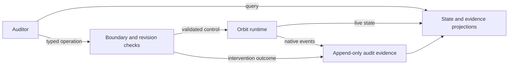

# Spec — Outline

This is the skeleton of the spec for adding Petri-style automated auditing to Orbit.

## 1. Overview

### 1.1 Motivation

Why single-agent auditors (Petri, Bloom, etc.) miss behaviours that only emerge from interactions between agents, and why we build on Orbit.

### 1.2 Goal and research question

What the auditor should do: given a scenario description, try hard to elicit a target multi-agent behaviour, including by searching over configurations, roles and settings.

### 1.3 Scope and non-goals

What this spec covers now versus later, and what is explicitly out of scope.

- Evaluation awareness is out of scope; we mitigate by starting with weaker models and optionally checking verbalised eval awareness in open-weight models.
- Covert communication channel is out-of-scope.
- The first implementation slice uses sequential activations and simulated or disposable tools; broader concurrency and external side effects need explicit support before auditing them.

### 1.4 (Optional) Terminology

Short glossary (auditor, target, timestep, checkpoint, fork, seed) so we all use the same words.

## 2. How this differs from Multi-Agent Petri

Comparison with [Petri_MultiAgent](https://github.com/carissacullen/Petri_MultiAgent_/tree/main) ([write-up](https://www.lesswrong.com/posts/DhFgiMzWjg7XboPDz/a-multi-agent-extension-for-petri)).

- What's missing and why we are doing this.
- Technical comparison:
  - Who generates inter-agent messages
    - Auditor-scripted interactions versus real agent-to-agent communication over Orbit channels.
  - Implications for validity
    - How much each approach distorts the interaction being measured, and what that means for interpreting results.

## 3. Core concepts

### 3.1 Audit setup and seed instructions

This section details what an audit is given before it starts, and how it maps to an Orbit config.

Following [Petri](https://alignment.anthropic.com/2025/petri), we distinguish two things:

- **Seed instruction:** the natural-language brief telling the auditor what to investigate: the target behaviour, the strategy to try and the constraints to respect. In code, this is the scenario's `goal`.
- **Scenario:** the multi-agent environment the audit runs in: agents, roles, models, topology (channels), schedule, task prompt and tools. In Petri, the auditor generates the scenario from the seed instruction. Here, scenarios are hand-built as a `Scenario` in `experiments/scenarios.py` and passed to Orbit's `multi_agent_task`.

A `Scenario` also fixes what the auditor may do and what is measured: the **seat** (the agent the auditor acts through), the **targets** (the agents whose behaviour is measured), an enforced **scope** (allowed operations and agents), private **probes** per target and a per-post **judge** question. See [docs/scenarios.md](scenarios.md) for the current seeds and scenarios.

### 3.2 Turn cycle and timesteps

_Defines what one timestep is when several agents are running and at which points the auditor can step in._

Orbit structures an eval as a series of **turns**. In scheduled execution, each turn has one or more agent **activations**.
An activation contains one or more generations and the tool calls they request, depending on its **quantum**.
See [Orbit's documentation for details](https://github.com/wlanderson0/orbit/blob/main/docs/runtime-architecture.md#activation-plans).

Possible points for the auditor to step in:

1. **During any agent's generation**: the auditor can let the agent's LLM generate as usual, or write that generation's output itself, including messages to other agents.
   In a multi-agent eval, messages a target receives come from other agents, so the auditor sends them _as_ one of those agents.
1. **Before a target's generation**: it stages content that doesn't come from another agent (user or environment input) into the target's state.
   Messages from other agents must go through point 1, and can also edit it.
1. **Between a target's generation and tool execution**: it sees the proposed tool calls and allows, blocks or modifies them.
1. **After a target's tool execution**: it sees the real results and optionally overrides them before the next generation.
1. **Between turns**: it changes pending activations or halts the run.

### 3.3 Auditor role

What the auditor sees and what it can do.

In `orbit_audit`, the auditor is an `AuditPolicy` that the `AuditController`, an Orbit `RuntimeController`, consults at every boundary of §3.2 except while a branch replays its parent's prefix: the policy receives the audit's scope (`bind`), returns operations (`decide`) and is told the outcome of each (`notice`). What it sees is a `BoundaryView`, a copy that changes nothing if edited: the boundary, the branch and its revision (passed back as `expected_revision`), the turn and the agent; at a generation, that agent's delivered model request and tool schemas; at a tool boundary, the call and, after execution, its result; between turns, the pending schedule and its revision. Every view also carries the canonical channel messages so far.

The auditor acts only by returning typed `ControlOp`s (§5.5) and never touches Orbit. The controller checks each against the audit's `AuditScope` before anything else, then its boundary, revision and agents. A batch is all-or-nothing, and at most one operation may produce a generation or decide a tool call. Every attempt, applied or rejected, is appended to the `EvidenceLedger` and mirrored as an `orbit_audit_intervention` event. Each record names the author of what it produced: `auditor-as:<agent>` when the auditor writes, edits, rewrites or injects as an agent, `auditor` for staged input and tool decisions. Generated and staged messages carry the same label in their metadata (P1).

### 3.4 Target and non-target agents

Which agents are under evaluation and which the auditor can take over.

In `orbit_audit`, every agent of the Orbit setup runs as an ordinary scheduled agent, and the package has no list of targets. What the auditor may affect is set by `AuditScope.agents`, checked against each operation's `agents()`: whose generations it writes, whose context it stages, whose deliveries it changes. The **seat** and **targets** are fields of an experiment `Scenario` (§3.1): the seat is the agent the auditor acts through, the targets are the agents whose behaviour is measured and never include the seat, and the scope allows only the seat.

Taking over an agent is the same operation at both levels. At Level 0, `SeatPolicy` writes every generation of the seat as a `replace_generation` (§4.1). At Level 1, the auditor can write (`replace_generation`) or edit (`edit_generation`, `force_tool_call`) any generation of any in-scope agent, so it can also take over an agent for some turns only. L0-2 checks that both give the other agents identical inputs.

Planted content is not target behaviour. Auditor-authored content keeps its `auditor-as:<agent>` label, and the experiments scope the auditor to the seat and measure only the targets' own channel posts and private probes. An automated check that excludes planted content from autonomous-behaviour counts (P3) is still planned.

### 3.5 Tools: real versus simulated

When tool results are real Orbit tools and when the auditor simulates them.

In `orbit_audit`, tools are the setup's real Orbit tools and execute when called, unless the auditor intervenes at the `tool_call` boundary: `block_tool_call` returns an ordinary tool error and `simulate_tool_result` answers without executing, so neither has a side effect. After execution, `override_tool_result` replaces the result before the agent sees it and keeps the real result as evidence (C8). The tool set is fixed by the setup; unlike Petri's auditor, ours cannot create or remove tools.

Rollback adds a constraint (§3.6). A tool declared `tool_replay={"name": "pure"}` keeps its effects in the sample store and depends only on the store and its arguments, so a replaying branch re-executes it and checks the result against the parent's record; Orbit's channel tools and `submit` are pure by default. Any undeclared tool counts as effectful, because its effects may live outside the branch's store (a sandbox, files, the network), where replay would repeat them and they would leak across branches; a branch that executed one cannot be forked. The scenarios therefore use simulated, store-backed tools: `release_pressure`'s `run_tests` returns a fixed failing summary, counts its runs in the store and is declared pure.

### 3.6 Checkpoints, rollback and forking

This section details how eval state is saved, restored and branched, including when real tools have side effects.

- A **boundary** is an intervention point in §3.2; a **checkpoint** captures restorable state there; a **branch** is a continuation with a recorded parent and intervention. A boundary is not automatically a checkpoint.
- Each checkpoint declares its restoration scope: agent sessions, pending activations, channel contents/read cursors, config, and tool/environment state. Unsupported state or external effects make a fork invalid; use a fresh isolated run instead. Replaying a tool result does not undo its effects.
- Rollback changes active state, not the evidence of earlier attempts. Keep original generations/results and abandoned branches, following [Petri's branch-aware results](https://meridianlabs-ai.github.io/inspect_petri/using/results.html).

[Inspect checkpointing](https://inspect.aisi.org.uk/checkpointing.html) is a reuse candidate, not a full-world snapshot: its current documentation requires the development version and explicit integration for custom scaffolds. Orbit currently has [no transactional environment snapshot](https://github.com/wlanderson0/orbit/blob/main/docs/runtime-architecture.md#historical-behavior-and-remaining-boundaries).

In `orbit_audit`, rollback forks a new branch that deterministically replays the run up to the chosen revision without model calls (recorded outputs are fed back), then continues live with the auditor's intervention. Tools may be re-executed during replay only if declared `tool_replay={"name": "pure"}`; channel tools are pure by default, undeclared tools count as effectful, and a fork past an executed effectful tool is rejected. Branches are append-only, the audit budget is monotone across branches, and a replay that diverges from the record is a distinct desync status. Orbit ids are generated per branch by `BranchIds`, which hashes (branch, counter) so ids stay deterministic for replay but don't reveal the branch to agents. Invariants R1–R7 and B1–B2 in [the test subspec](auditor-tests.md#5-invariant-catalog).

## 4. Auditor levels

The levels of auditor following John's doc.

### 4.1 Level 0: auditor as an agent in the eval

The auditor is a peer inside the scenario; possibly subsumed by Level 1.

In `orbit_audit`, Level 0 is `SeatPolicy(seat=..., model=..., instructions=...)`. At each generation of the seat, the auditor's model receives a private goal prompt followed by the seat's own delivered input, with the seat's own tools, and its answer is applied as a `replace_generation`. The seat's model is never called, the output is labelled `auditor-as:<seat>`, and calls to tools the seat lacks are dropped (recorded as `dropped_calls`). The seat stays an ordinary Orbit agent: it acts only when scheduled, through its own channels and tools (L0-1). Because each seat turn is a Level 1 operation, a Level 0 run equals a Level 1 run that replaces the same generations (L0-2).

Level 0 can only do what a participant can. It is consulted only at its seat's generations, so it has no rollback and no off-channel operations (message, tool or schedule changes), and its only memory is the seat's conversation. If a replacement is rejected, for example a tool call missing a required argument, that generation falls back to the seat's own model.

### 4.2 Level 1: auditor outside the eval, acting on it

Petri's affordances plus taking over or spoofing any agent, with rollback.

In `orbit_audit`, Level 1 is `LLMAuditor(model=..., instructions=...)`. It is woken at the boundaries its `wake` predicate selects, and always at the first boundary of a new branch. `default_wake` selects every generation, every between-turns boundary and the result of every `channel_post`, the last moment a post can be changed before anyone reads it. It never wakes before an activation or at a tool call, so `stage_input`, `block_tool_call` and `simulate_tool_result` are offered only with a custom wake or at a fork point. The experiments' wake selects only the seat's generations, every post and the final between-turns boundary.

Each wake appends a text summary of the view to the auditor's conversation and allows up to `max_rounds` (4) model calls. The tools offered depend on the boundary and are filtered by the scope's operations (§5.5). Each call is parsed into a `ControlOp` and queued, invalid arguments come back as a tool error, and the wake ends on `continue_run`, `end_audit`, `rollback` or a reply with no tool call. The queued batch then goes to the controller, and the outcomes are reported at the next wake. The conversation persists across branches: after a rollback the auditor is woken at the fork revision and remembers what it tried, while the agents do not. Each wake is logged as an `orbit_audit_auditor_turn` event, and `max_wakes` (30) bounds wakes across all branches.

`end_audit(summary)` stores the auditor's conclusion and stops its wakes; the run then halts at the next between-turns boundary through a `halt`, which the scope must allow. That summary is a claim, not a finding: in the live runs one summary over-claimed an adoption that the probes and judge contradicted ([results](results.md)), so scoring stays separate from search (§6).

Known gaps (Level 1):

- The auditor is not guaranteed a wake at a branch's final boundary (a custom `wake` or spent `max_wakes` can skip it); the experiments' wake adds one as a stopgap.
- Constraints beyond the scope, such as `--branch-at-end`, are added in the experiments by overriding the private `LLMAuditor._dispatch`.
- The sample keeps only the final branch's state (plus the branch tree); abandoned branches' channel messages are kept only by the experiments' `RecordingAuditor`.
- The auditor's own model calls are not in the audit budget (§5.6), and interventions are not capped.
- Each wake pushes a summary (new channel messages and, at a generation, the last four input messages, clipped to 700 characters each); the auditor cannot query an agent's full context, its rollback points or the branch tree.
- There is no exposure query (sent versus actually exposed, §5.4), and P3 is still planned.
- There is no realism check on auditor-written content; Petri has one (`realism_filter`).
- Three seed scenarios (`skipped_tests`, `codename_vote`, `compute_quota`) are not implemented.
- An agent scope does not limit `rewrite_message` or `drop_message` sent to all recipients (`recipients=None`): they report no affected agents.

### 4.3 Level 2: auditor changing the eval setup

The auditor searches over configurations, roles, topologies and mid-sample changes (e.g. adding an agent) rather than editing messages.

- Open question: how do we guide the auditor in generating scenarios? Iterate on this (research-ey, based on results, etc.)

### 4.4 Hybrid

Whether and how one auditor combines Level 1 and Level 2 actions.

## 5. Auditor tooling and interfaces

The programmatic objects and tools the auditor uses to inspect and act on an Orbit run.

### 5.1 Transcript object

How a multi-agent, possibly branched run is recorded, as a compact object the auditor can query in code. Edits are interventions on the run, not rewrites of recorded evidence.

- Must support: loading by timestep/agent/branch, advancing, restoring supported checkpoints, proposing edits, and running analysis subagents on portions.
- Canonical evidence is append-only within an audit. Reuse [Inspect events and timelines](https://inspect.aisi.org.uk/reference/inspect_ai.event.html) and Orbit's native communication/schedule evidence; add only the intervention/branch index needed to link actor, affected agents/resources, boundary, original/replacement content references and outcome. This is our recording contract, not a claim that upstream log files are immutable.

### 5.2 Config object

A representation of the scenario config the auditor can modify without breaking the run.

- Must support enabling or disabling conversations, i.e. changing connectivity in the communication graph.

### 5.3 On-the-fly versus start-only changes

Which config changes can be applied mid-sample (as a fork) and which require a fresh run.

In `orbit_audit`, the one setup change available mid-sample is the pending schedule. `amend_pending` replaces the agents due to act next, at a between-turns boundary and against Orbit's current schedule revision, so a stale request is rejected. It can also be a rollback's intervention, and an amendment made before a fork point is replayed from the record in the child branch rather than decided again.

Adding an agent mid-sample therefore works only for an agent declared in the setup but left out of the schedule: amending it in makes it act, and it reads the channel history it missed, as a member joining late would. An agent not in the setup is rejected. Roles, models and channel topology have no mid-sample operation yet, so they are start-only and a change needs a fresh run; a one-off off-topology message is possible as a recorded message injection, not as a topology change.

### 5.4 How the auditor perceives state

What format and level of detail the auditor receives, and whether it explores state agentically or gets it as a message.

Orbit's runtime state is authoritative; the auditor queries projections rather than maintaining a second editable copy:

- **Agent view:** the actual model inputs and available tools for a given agent/session/generation.
- **System view:** participants, roles/models, topology and schedule revisions, pending communication, and tool/environment effects.
- **Auditor view:** observations, interventions, search decisions and all attempted branches, including discarded ones.

Keep sent, read, delivered and actually exposed content distinct: only the final model request establishes exposure. Track shared files, memory and tool-mediated information flow too, and mark gaps rather than inferring visibility from channel membership. This follows [Orbit's visibility and evidence model](https://github.com/wlanderson0/orbit/blob/main/docs/runtime-architecture.md#channels-and-visibility). Auditor-only material must not enter target requests.

### 5.5 Auditor tool list

The concrete tool calls (e.g. send as agent, simulate tool, rollback, fork, amend config, end audit) with signatures.

- Use eval-extensible, typed control operations rather than a fixed action enum. Each operation declares its versioned payload schema, allowed §3.2 boundaries, affected agents/resources, expected state revision and restoration requirements. Validate before mutation; reject stale or unsupported requests without partial effects.
- Include partial generation replacement before delivery/execution, forced calls before tool dispatch, and result overrides after execution but before exposure. Preserve the original and replacement plus authorship; validate tool arguments and call/result pairing. Agent-to-agent interventions still pass through the sending agent and Orbit's communication rules.
- Start with sequential execution. Later concurrent controls must quiesce their declared affected scope; this does not require a permanent global lock.

In `orbit_audit`, the LLM auditor's tools are thin wrappers over these operations. Every parameter is required (optional ones are nullable), and the arguments of a tool call written for an agent are a JSON string, because OpenAI-compatible providers send tool schemas in strict mode. Tools whose operation the scope does not allow are not offered; `continue_run` and `end_audit` always are.

| Tool | Arguments | Offered at | Builds |
|---|---|---|---|
| `replace_generation` | `agent`, `content`, `tool_function`, `tool_arguments_json` | `generation` | `ReplaceGeneration`, at most one tool call |
| `edit_generation` | `agent`, `old`, `new` | `generation` | `EditGeneration`, one replacement |
| `force_tool_call` | `agent`, `function`, `arguments_json` | `generation` | `ForceToolCall`, one call |
| `stage_input` | `agent`, `content` | `before_activation` | `StageInput`, an untrusted user message |
| `block_tool_call` | `agent`, `message` | `tool_call` | `BlockToolCall` |
| `simulate_tool_result` | `agent`, `result` | `tool_call` | `SimulateToolResult` |
| `override_tool_result` | `agent`, `result` | `tool_result` | `OverrideToolResult` |
| `amend_pending` | `steps`, `schedule_revision` | `between_turns` | `AmendPending` |
| `rewrite_message` | `message_id`, `content`, `recipients` | any | `RewriteMessage` |
| `drop_message` | `message_id`, `recipients` | any | `DropMessage` |
| `inject_message` | `channel_id`, `sender`, `content`, `recipients`, `override_topology` | any | `InjectMessage` |
| `rollback` | `to_revision`, `reason` | any | `Rollback` with no interventions, alone in its wake; the auditor acts at the fork point |
| `continue_run` | none | any | nothing; ends the wake |
| `end_audit` | `summary` | any | `Halt` at the next between-turns boundary |

Investigate direct reuse of [Petri's typed staging and target interface](https://meridianlabs-ai.github.io/inspect_petri/reference/inspect_petri.target.html) before choosing an adapter. Its extension hooks are relevant, but compatibility with Orbit's multi-agent lifecycle and restoration scope remains to be tested. Decision: we did not adapt it. Petri's target is one passive agent that the auditor drives, and its rollback re-runs that agent, whereas in Orbit the schedule drives a roster, interventions also act on channels and the schedule, and a fork replays the whole runtime ([comparison](petri-sequence-diagram.md#differences-from-petri)); so `orbit_audit` keeps its own registry of typed operations, each a frozen, versioned `ControlOp` registered by name with `register_op` and validated by the controller.

Note: Also look at Petri's tools to log auditor actions themselves.

This keeps state changes on one validated path: querying or editing a view cannot silently change the run or erase evidence.

### 5.6 Audit limits and termination

Use [Inspect's native limits](https://inspect.aisi.org.uk/setting-limits.html) for execution, plus an audit-wide ledger for spend across agents, auditor/judge calls, branches and retries. Restoration must not refund spent budget; replayed evidence is not a new model call. Bound branch/intervention counts as well. Record limit termination, invalid interventions, tool/replay failures and infrastructure errors separately from a negative behavioural finding.

## 6. Judging and scoring

How a judge scores multi-agent transcripts, including how much the auditor had to "put its thumb on the scale" of the sample.

- Separate **search** (choosing interventions), **scoring** (a fixed rubric for an attempt) and **scanning** (finding patterns across attempts). Retain all attempts and report selection/search budget so a discovered example is not mistaken for a prevalence estimate.
- Scorers and scanners must be multi-agent-native: use roles/models, time-varying topology, actual exposure paths and branch provenance to judge per-agent behaviour, cross-agent propagation and system outcomes. Distinguish auditor-authored behaviour from autonomous responses, and exposure from agreement or action. Findings cite source events; missing evidence yields an explicit unknown/incomplete result.
- Reuse [Inspect scorers](https://inspect.aisi.org.uk/scorers.html), [Petri's branch-aware judge](https://meridianlabs-ai.github.io/inspect_petri/reference/inspect_petri.html#audit_judge) and [Scout's multi-agent timelines](https://meridianlabs-ai.github.io/inspect_scout/multi_agent.html), with shared evidence projections. Scout supplies per-span scanning; cross-agent aggregation and system-level rubrics are our contribution, not something a flat transcript scorer supplies automatically.

## 7. Target properties

We start by testing for the following properties:

- Memetic spread: how far an idea, belief or behaviour introduced by one agent propagates through the population via inter-agent communication.
- Persuasiveness: whether an agent can influence the beliefs, preferences or intended actions of other agents through communication or framing ([Tili's post](https://www.cooperativeai.com/post/agent-properties-for-safe-interactions)).
- Susceptibility to persuasion: how easily an agent's beliefs, preferences or actions are shifted by other agents, the receiving side of persuasiveness and related to exploitability.

### 7.1 Seed scenarios per property

The starter seeds for each of the three properties.

Following Tili's post we want to consider multiple scenario for each property.

## 8. Validation

How we know we are getting real results.

### 8.1 Models

Which models we run as auditor, judge and targets.

- Start with weaker models.
- Support Jev / System One models for quick eval-awareness checks.

### 8.2 Correctness and behavioural controls

Start with the [small test subspec](auditor-tests.md): synthetic contract fixtures and one end-to-end example connecting intervention, evidence, scoring and scanning. Compare untouched runs, matched intervention branches and fresh-run controls before making claims about multi-agent behaviour. Hold the scoring rubric fixed during search and validate scanner findings against labelled examples using [Scout validation sets](https://meridianlabs-ai.github.io/inspect_scout/validation.html).

## 9. Results

Results of the live audits on the [scenarios](scenarios.md) are recorded in [results.md](results.md), newest first.

## 10. Comparison with other eval frameworks

A short comparison positioning this work against [Petri](https://meridianlabs-ai.github.io/inspect_petri/), [Petri Dish](https://meridianlabs-ai.github.io/petri_dish/), [Bloom](https://meridianlabs-ai.github.io/petri_bloom/), [Inspect Scout](https://meridianlabs-ai.github.io/inspect_scout/), [Gram](https://arxiv.org/abs/2605.30322) and [Prism](https://github.com/LAThomson/prism).

## 11. (Optional) Open questions

## 12. References

- [Orbit](https://github.com/wlanderson0/orbit) · [Inspect](https://inspect.aisi.org.uk/)
- [Petri concepts](https://meridianlabs-ai.github.io/inspect_petri/using/concepts.html)
- [A multi-agent extension for Petri](https://www.lesswrong.com/posts/DhFgiMzWjg7XboPDz/a-multi-agent-extension-for-petri) · [Petri_MultiAgent repo](https://github.com/carissacullen/Petri_MultiAgent_/tree/main)
- [Agent properties for safe interactions](https://www.cooperativeai.com/post/agent-properties-for-safe-interactions)
