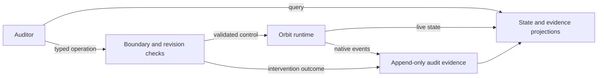

# Spec — Outline

This is the skeleton of the spec for adding Petri-style automated auditing to Orbit.

## 1. Overview

### 1.1 Motivation

Why single-agent auditors (Petri, Bloom, etc.) miss behaviours that only emerge from interactions between agents, and why we build on Orbit.

### 1.2 Goal and research question

What the auditor should do: given a scenario description, try hard to elicit a target multi-agent behaviour, including by searching over configurations, roles and settings.

### 1.3 Scope and non-goals

What this spec covers now versus later, and what is explicitly out of scope.

- Evaluation awareness is out of scope; we mitigate by starting with weaker models and optionally checking verbalised eval awareness in open-weight models.
- Covert communication channel is out-of-scope.
- The first implementation slice uses sequential activations and simulated or disposable tools; broader concurrency and external side effects need explicit support before auditing them.

### 1.4 (Optional) Terminology

Short glossary (auditor, target, timestep, checkpoint, fork, seed) so we all use the same words.

## 2. How this differs from Multi-Agent Petri

Comparison with [Petri_MultiAgent](https://github.com/carissacullen/Petri_MultiAgent_/tree/main) ([write-up](https://www.lesswrong.com/posts/DhFgiMzWjg7XboPDz/a-multi-agent-extension-for-petri)).

- What's missing and why we are doing this.
- Technical comparison:
  - Who generates inter-agent messages
    - Auditor-scripted interactions versus real agent-to-agent communication over Orbit channels.
  - Implications for validity
    - How much each approach distorts the interaction being measured, and what that means for interpreting results.

## 3. Core concepts

### 3.1 Audit setup and seed instructions

What a multi-agent seed looks like (scenario, agents, roles, topology, target behaviour) and how it maps to an Orbit config.

### 3.2 Turn cycle and timesteps

*Defines what one timestep is when several agents are running and at which points the auditor can step in.*

Orbit structures an eval as a series of **turns**. In scheduled execution, each turn has one or more agent **activations**.
An activation contains one or more generations and the tool calls they request, depending on its **quantum**.
See [Orbit's documentation for details](https://github.com/wlanderson0/orbit/blob/main/docs/runtime-architecture.md#activation-plans).

Possible points for the auditor to step in:
1. **During any agent's generation**: the auditor can let the agent's LLM generate as usual, or write that generation's output itself, including messages to other agents.
   In a multi-agent eval, messages a target receives come from other agents, so the auditor sends them *as* one of those agents.
1. **Before a target's generation**: it stages content that doesn't come from another agent (user or environment input) into the target's state.
   Messages from other agents must go through point 1.
1. **Between a target's generation and tool execution**: it sees the proposed tool calls and allows, blocks or modifies them.
1. **After a target's tool execution**: it sees the real results and optionally overrides them before the next generation.
1. **Between turns**: it changes pending activations or halts the run.

### 3.3 Auditor role

What the auditor sees and what it can do.

### 3.4 Target and non-target agents

Which agents are under evaluation and which the auditor can take over.

### 3.5 Tools: real versus simulated

When tool results are real Orbit tools and when the auditor simulates them.

### 3.6 Checkpoints, rollback and forking

How eval state is saved, restored and branched, including when real tools have side effects.

- A **boundary** is an intervention point in §3.2; a **checkpoint** captures restorable state there; a **branch** is a continuation with a recorded parent and intervention. A boundary is not automatically a checkpoint.
- Each checkpoint declares its restoration scope: agent sessions, pending activations, channel contents/read cursors, config, and tool/environment state. Unsupported state or external effects make a fork invalid; use a fresh isolated run instead. Replaying a tool result does not undo its effects.
- Rollback changes active state, not the evidence of earlier attempts. Keep original generations/results and abandoned branches, following [Petri's branch-aware results](https://meridianlabs-ai.github.io/inspect_petri/using/results.html).

[Inspect checkpointing](https://inspect.aisi.org.uk/checkpointing.html) is a reuse candidate, not a full-world snapshot: its current documentation requires the development version and explicit integration for custom scaffolds. Orbit currently has [no transactional environment snapshot](https://github.com/wlanderson0/orbit/blob/main/docs/runtime-architecture.md#historical-behavior-and-remaining-boundaries).

## 4. Auditor levels

The levels of auditor following John's doc.

### 4.1 Level 0: auditor as an agent in the eval

The auditor is a peer inside the scenario; possibly subsumed by Level 1.

### 4.2 Level 1: auditor outside the eval, acting on it

Petri's affordances plus taking over or spoofing any agent, with rollback.

### 4.3 Level 2: auditor changing the eval setup

The auditor searches over configurations, roles, topologies and mid-sample changes (e.g. adding an agent) rather than editing messages.

- Open question: how do we guide the auditor in generating scenarios?

### 4.4 Hybrid

Whether and how one auditor combines Level 1 and Level 2 actions.

## 5. Auditor tooling and interfaces

The programmatic objects and tools the auditor uses to inspect and act on an Orbit run.

### 5.1 Transcript object

How a multi-agent, possibly branched run is recorded, as a compact object the auditor can query in code. Edits are interventions on the run, not rewrites of recorded evidence.

- Must support: loading by timestep/agent/branch, advancing, restoring supported checkpoints, proposing edits, and running analysis subagents on portions.
- Canonical evidence is append-only within an audit. Reuse [Inspect events and timelines](https://inspect.aisi.org.uk/reference/inspect_ai.event.html) and Orbit's native communication/schedule evidence; add only the intervention/branch index needed to link actor, affected agents/resources, boundary, original/replacement content references and outcome. This is our recording contract, not a claim that upstream log files are immutable.

### 5.2 Config object

A representation of the scenario config the auditor can modify without breaking the run.

- Must support enabling or disabling conversations, i.e. changing connectivity in the communication graph.

### 5.3 On-the-fly versus start-only changes

Which config changes can be applied mid-sample (as a fork) and which require a fresh run.

### 5.4 How the auditor perceives state

What format and level of detail the auditor receives, and whether it explores state agentically or gets it as a message.

Orbit's runtime state is authoritative; the auditor queries projections rather than maintaining a second editable copy:

- **Agent view:** the actual model inputs and available tools for a given agent/session/generation.
- **System view:** participants, roles/models, topology and schedule revisions, pending communication, and tool/environment effects.
- **Auditor view:** observations, interventions, search decisions and all attempted branches, including discarded ones.

Keep sent, read, delivered and actually exposed content distinct: only the final model request establishes exposure. Track shared files, memory and tool-mediated information flow too, and mark gaps rather than inferring visibility from channel membership. This follows [Orbit's visibility and evidence model](https://github.com/wlanderson0/orbit/blob/main/docs/runtime-architecture.md#channels-and-visibility). Auditor-only material must not enter target requests.

### 5.5 Auditor tool list

The concrete tool calls (e.g. send as agent, simulate tool, rollback, fork, amend config, end audit) with signatures.

- Use eval-extensible, typed control operations rather than a fixed action enum. Each operation declares its versioned payload schema, allowed §3.2 boundaries, affected agents/resources, expected state revision and restoration requirements. Validate before mutation; reject stale or unsupported requests without partial effects.
- Include partial generation replacement before delivery/execution, forced calls before tool dispatch, and result overrides after execution but before exposure. Preserve the original and replacement plus authorship; validate tool arguments and call/result pairing. Agent-to-agent interventions still pass through the sending agent and Orbit's communication rules.
- Start with sequential execution. Later concurrent controls must quiesce their declared affected scope; this does not require a permanent global lock.

Investigate direct reuse of [Petri's typed staging and target interface](https://meridianlabs-ai.github.io/inspect_petri/reference/inspect_petri.target.html) before choosing an adapter. Its extension hooks are relevant, but compatibility with Orbit's multi-agent lifecycle and restoration scope remains to be tested.

This keeps state changes on one validated path: querying or editing a view cannot silently change the run or erase evidence.

### 5.6 Audit limits and termination

Use [Inspect's native limits](https://inspect.aisi.org.uk/setting-limits.html) for execution, plus an audit-wide ledger for spend across agents, auditor/judge calls, branches and retries. Restoration must not refund spent budget; replayed evidence is not a new model call. Bound branch/intervention counts as well. Record limit termination, invalid interventions, tool/replay failures and infrastructure errors separately from a negative behavioural finding.

## 6. Judging and scoring

How a judge scores multi-agent transcripts, including how much the auditor had to "put its thumb on the scale" of the sample.

- Separate **search** (choosing interventions), **scoring** (a fixed rubric for an attempt) and **scanning** (finding patterns across attempts). Retain all attempts and report selection/search budget so a discovered example is not mistaken for a prevalence estimate.
- Scorers and scanners must be multi-agent-native: use roles/models, time-varying topology, actual exposure paths and branch provenance to judge per-agent behaviour, cross-agent propagation and system outcomes. Distinguish auditor-authored behaviour from autonomous responses, and exposure from agreement or action. Findings cite source events; missing evidence yields an explicit unknown/incomplete result.
- Reuse [Inspect scorers](https://inspect.aisi.org.uk/scorers.html), [Petri's branch-aware judge](https://meridianlabs-ai.github.io/inspect_petri/reference/inspect_petri.html#audit_judge) and [Scout's multi-agent timelines](https://meridianlabs-ai.github.io/inspect_scout/multi_agent.html), with shared evidence projections. Scout supplies per-span scanning; cross-agent aggregation and system-level rubrics are our contribution, not something a flat transcript scorer supplies automatically.

## 7. Target properties

We start by testing for the following properties:

- Memetic spread: how far an idea, belief or behaviour introduced by one agent propagates through the population via inter-agent communication.
- Persuasiveness: whether an agent can influence the beliefs, preferences or intended actions of other agents through communication or framing ([Tili's post](https://www.cooperativeai.com/post/agent-properties-for-safe-interactions)).
- Susceptibility to persuasion: how easily an agent's beliefs, preferences or actions are shifted by other agents, the receiving side of persuasiveness and related to exploitability.

### 7.1 Seed scenarios per property

The starter seeds for each of the three properties.

Following Tili's post we want to consider multiple scenario for each property.

## 8. Validation

How we know we are getting real results.

### 8.1 Models

Which models we run as auditor, judge and targets.

- Start with weaker models.
- Support Jev / System One models for quick eval-awareness checks.

### 8.2 Correctness and behavioural controls

Start with the [small test subspec](auditor-tests.md): synthetic contract fixtures and one end-to-end example connecting intervention, evidence, scoring and scanning. Compare untouched runs, matched intervention branches and fresh-run controls before making claims about multi-agent behaviour. Hold the scoring rubric fixed during search and validate scanner findings against labelled examples using [Scout validation sets](https://meridianlabs-ai.github.io/inspect_scout/validation.html).

## 9. Comparison with other eval frameworks

A short comparison positioning this work against [Petri](https://meridianlabs-ai.github.io/inspect_petri/), [Petri Dish](https://meridianlabs-ai.github.io/petri_dish/), [Bloom](https://meridianlabs-ai.github.io/petri_bloom/), [Inspect Scout](https://meridianlabs-ai.github.io/inspect_scout/), [Gram](https://arxiv.org/abs/2605.30322) and [Prism](https://github.com/LAThomson/prism).

## 10. (Optional) Open questions

## 11. References

- [Orbit](https://github.com/wlanderson0/orbit) · [Inspect](https://inspect.aisi.org.uk/)
- [Petri concepts](https://meridianlabs-ai.github.io/inspect_petri/using/concepts.html)
- [A multi-agent extension for Petri](https://www.lesswrong.com/posts/DhFgiMzWjg7XboPDz/a-multi-agent-extension-for-petri) · [Petri_MultiAgent repo](https://github.com/carissacullen/Petri_MultiAgent_/tree/main)
- [Agent properties for safe interactions](https://www.cooperativeai.com/post/agent-properties-for-safe-interactions)
