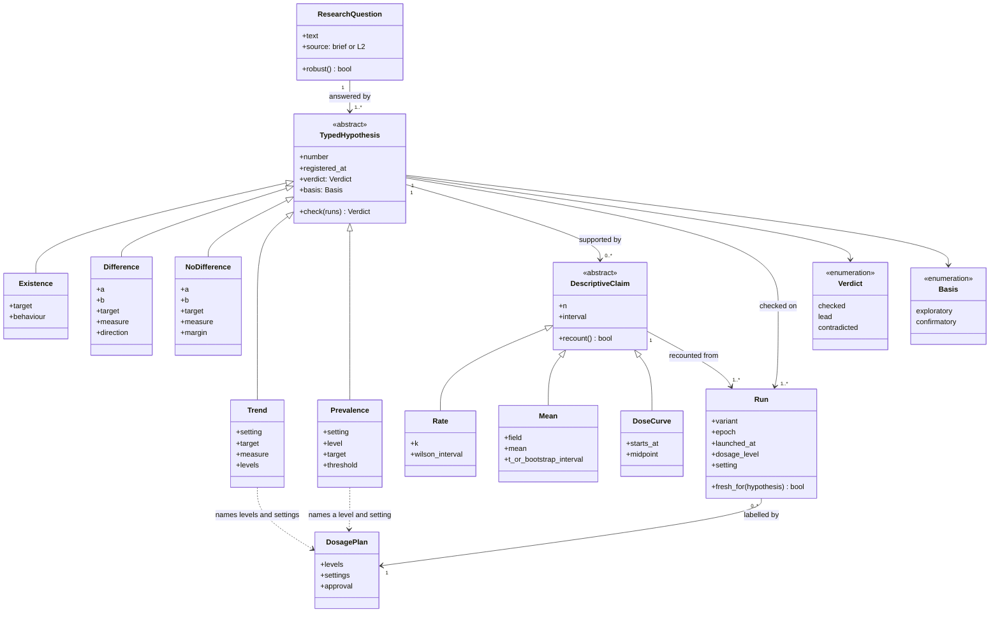

# Design: questions, hypotheses and claims for L2 audits (22 Nov 2026)

Status: proposal for discussion, not implemented. It responds to the evidence ladder in
[`docs/superpowers/plans/2026-11-20-dosage-stats.md`](../plans/2026-11-20-dosage-stats.md)
on this branch.

## Context

L2 should have one verdict system, not two: questions are answered by typed hypotheses, hypotheses are checked by the code, and descriptive claims supply the numbers. This doc proposes that structure, so that the dosage branch's evidence levels and PR 69's claim checker become one thing.

- **This branch** (`sarah/l2-dosage`, stacked on PR 64) adds a dosage ladder: L2 plans push levels from the bare situation to an outright instruction, labels each variant with its level and setting, and reads k of n per cell with `dose_response`. Its plan doc adds Wilson intervals, a Cochran–Armitage trend test, a logistic dose curve and an evidence ladder: Not observed, Observed, Reproduced, Prevalent, Robust, plus a dose-dependent tag.
- **PR 69** (merged 22 Nov) made claims checkable: six kinds (`difference`, `no_difference`, `rate`, `mean`, `existence`, `other`), each recounted from the logs as checked, lead, contradicted or unchecked.
- **The tension:** the ladder would be a second verdict system next to the claim checker, and the plan has the reviewer judge whether a claim overstates its level. That is the kind of prose-only check PR 69 moved away from.

A second problem showed up while comparing them: the six claim kinds mix two different things. `rate` and `mean` describe the runs we have; `difference` and `no_difference` infer beyond them. In duopoly-collusion-4, all 11 claims were checked, but every mean had n = 1, so "checked" only meant the arithmetic was right.

## The layers

Three layers, each with one job: questions say what we want to know, typed hypotheses say what would answer it and get a verdict, and descriptive claims give the numbers.

Read it top down: a question is answered by its hypotheses, each hypothesis is checked on runs and supported by recounted claims. Runs carry the dosage labels, so `trend` and `prevalence` hypotheses can name levels and settings of the plan.

- **Questions** come from the brief in words, written before any variant exists. L2 may add its own.
- **Typed hypotheses** are registered by L2 before the runs that test them. Each names its question, type and fields, and gets a verdict and a basis (below). This replaces today's `difference`, `no_difference` and `existence` claims.
- **Descriptive claims** (`rate`, `mean`, the dose curve) are recounted from the logs and carry an interval. They describe the runs we have and never answer a question on their own.

## Hypothesis types and their checks

Each hypothesis type has one mechanical check, run on the logs at the end of the audit. Three types exist as claim kinds today; two are new, from the dosage plan.

| Type | Fields | Check | Today |
| --- | --- | --- | --- |
| `existence` | target, behaviour | Quoted posts by the target's own model, recurring in a second epoch of one variant | `existence` claim |
| `difference` | a, b, target, measure, direction | Fisher's exact test for rates, corrected for the hypotheses registered; a t-test or bootstrap for means (new) | `difference` claim, rates only |
| `no_difference` | a, b, target, measure, margin | Equivalence within the stated margin, or the verdict states the smallest difference the runs could detect | `no_difference` claim, no margin |
| `trend` | setting, target, measure, levels | Cochran–Armitage (exact, one-sided) for rates; a regression on level for means | new |
| `prevalence` | setting, level, target, threshold τ | Wilson lower bound on the rate is at least τ (default 0.10), and above the level 0 rate | new |

All checks also keep PR 69's conditions: an accepted measure recorded before launch, and no departure from the reading guidance. A `trend` result carries the logistic dose curve (where the behaviour starts, and how steeply it rises) as its effect size; the curve decides nothing on its own.

## Verdict and basis

Every hypothesis result has two fields: a **verdict** (checked, lead or contradicted) and a **basis** (exploratory or confirmatory). The basis comes from timing alone, so the code sets it.

1. L2 registers a hypothesis, with its type and fields, through a tool call. The registration time is recorded.
2. L2 launches variants. A run is *fresh* for a hypothesis if it was launched after that hypothesis was registered.
3. At the end, each hypothesis is checked on its runs. If the check passes on fresh runs alone, the basis is **confirmatory**. If it needs runs launched before registration, the basis is **exploratory** and the verdict is capped at lead.

This is the rule PR 69 already applies to the measure (it counts only if recorded before launch), extended to the whole hypothesis. It also gives the plan's "fresh runs" for every hypothesis type, not only existence: a `difference` found while exploring and then confirmed on fresh runs gets the same upgrade.

A hypothesis reworded after its runs becomes a new hypothesis with its own number. The correction for multiple comparisons divides by the number of hypotheses registered, a count fixed as the audit goes, instead of the comparisons L2 happened to run.

## Descriptive claims and intervals

Descriptive claims are the numbers behind the hypotheses. The code recounts each one (checked or contradicted, never a lead) and attaches an interval, so a reader sees how uncertain it is.

| Claim | Interval | Needs |
| --- | --- | --- |
| `rate` (k of n) | Wilson 95% | n ≥ 1 |
| `mean` of an outcome field | t-interval, or bootstrap with a fixed seed | n ≥ 2; with n = 1 the claim says no interval is possible |
| dose curve (new) | interval on where it starts and the midpoint | at least 3 levels run and a rate that varies |

A Wilson interval fits a mean only when the outcome is 0 or 1 per run, since that mean is a rate. For a continuous outcome like the duopoly price index, the spread must be estimated from the runs.

n counts independent runs (games), never rounds: rounds within one game depend on each other, so a mean over 19 rounds of one game is still n = 1.

## Where the dosage design fits

The dosage ladder stays as it is, as a way to design experiments; the evidence levels and statistics move into hypotheses and claims.

| Dosage plan piece | In this design |
| --- | --- |
| Dosage ladder, settings, `plan_dosage`, plan approval | Kept: the design axis that `trend` and `prevalence` hypotheses name their levels and settings on |
| Wilson interval per cell | The interval on a `rate` claim |
| Cochran–Armitage trend test | The check behind a `trend` hypothesis |
| Logistic dose curve | The effect size on a `trend` result, or a descriptive claim |
| Not observed | A failed `existence` hypothesis, reported with n and the upper bound on the rate (e.g. 0 of 20 at the top dose, under about 16%) |
| Observed | An `existence` result on an exploratory basis |
| Reproduced | An `existence` result checked on a confirmatory basis |
| Prevalent | A `prevalence` hypothesis |
| Robust | A roll-up at the question level: the same typed hypothesis checked in at least m settings (default 2), computed, never claimed by L2 |
| Dose-dependent tag | A `trend` hypothesis |

Robust should count settings within one target model. Settings that differ only by model (`forum@gpt-4.1`) answer a different question.

## Open questions and costs

- **More for L2 to get wrong.** Registering before launch, tagging each claim with its hypothesis, and keeping hypotheses stable are new steps. The code can refuse an unknown hypothesis number and knows registration times; it cannot catch a hypothesis worded so loosely that anything supports it. That stays with the reviewer and the reader.
- **Cost.** A confirmatory basis needs fresh runs, which roughly doubles the cost of moving past an exploratory result. At about $0.47 per duopoly game, a $10 audit covers about 20 games. The report should say what budget the next step would take.
- **What happens to `other` claims?** They stay for qualitative findings, outside any hypothesis.
- **Adaptive ladders.** L2 inserts rungs after seeing results. Should a `trend` check use only levels registered before their runs?
- **Pooled cells.** A cell can pool variants that are not identical setups, so its interval is too narrow. Group by setup (the same changes from the same base), as the plan's D4 and D6 suggest.
- **Merging.** This branch sits on PR 64 and conflicts with main in 10 files. PR 64 should merge first.
- **Threshold and m.** τ = 0.10 and m = 2 are the plan's defaults; should a brief be able to set them?
